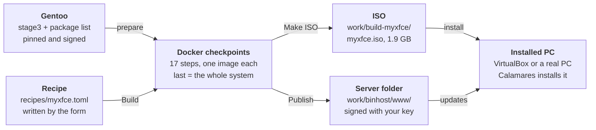

# lfsbuilder: how it works

A walk-through of building your own Xfce distribution (Odyssey Linux) from a recipe to a running system in VirtualBox, following the questions asked along the way (2026-11-19).

## The big picture

The recipe says what you want; Gentoo provides the pieces; Docker assembles them in saved steps; QEMU tests the result; the ISO carries it to a PC; your signed server keeps it updated.

1. **Recipe**: a text file in `recipes/` that describes the system.
2. **Prepare**: download Gentoo's starter system and package list, check their signatures.
3. **Check**: ask Portage whether the choices fit together.
4. **Build**: assemble the system in Docker, one saved step (checkpoint) at a time.
5. **Publish**: put the packages and repositories, signed, in the server folder.
6. **Make ISO**: pack the system into a bootable ISO and test it in QEMU.
7. **Install**: boot the ISO in VirtualBox or on a PC and run the installer.
8. **Updates**: installed PCs fetch new releases from your server.



Everything except the installed PC lives on this computer; only the ISO and the updates leave it.

### Why Gentoo underneath

Gentoo is a distribution you assemble yourself. Your distribution is a Gentoo with your choices, your name and your look.

| Gentoo feature | What it gives lfsbuilder |
| --- | --- |
| Portage, the package manager | Works out dependencies: ask for Xfce and it finds the ~400 packages Xfce needs |
| USE flags | A switch per feature; they become the form's checkboxes |
| Official binary packages | Most packages come precompiled, so a desktop builds in about 30 minutes instead of a day |
| Pinned versions | The recipe names a stage3 date and a package-list commit, so a build next year gives the same system |

## Step 1: the recipe

The recipe is the only input: the same recipe always gives the same system. Create it with the form, not by hand.

**Where and how to name it.** Recipes live in the `recipes/` folder. The file name is the recipe's name: lower-case letters, digits and `_`, ending in `.toml` (`myxfce.toml` yes, `My-Xfce.toml` no). It also names the build folder (`work/build-myxfce/`) and the ISO (`myxfce.iso`).

**Your recipes and logos stay on your PC.** Git (lfsbuilder's repository) holds only the tool: the five example recipes (example, gnome, plasma, xfce, openrc) and Argo's logo, the default. Your own recipes in `recipes/` and logos in `branding/` are left out by `.gitignore`, so they never show up as changes. Back them up yourself, together with `work/binhost/gnupg` (your signing key).

**Start the form** on an existing recipe, then use **Save as…** so the original stays untouched:

```
cd ~/dev/lfsbuilder
.venv/bin/python -m lfsbuilder.form recipes/xfce.toml
```

| Form page | What you choose there |
| --- | --- |
| System | Distribution name and version, logo and label, update server, systemd or OpenRC, processor, kernel, language, time zone, keyboard, host name, network |
| Desktop and software | None, GNOME, KDE Plasma or Xfce; programs as checkboxes in plain words (Firefox, LibreOffice, VLC, nano, Vim, tmux, htop, Git, OpenSSH) |
| Users | Accounts (Add, Remove, Set password…), root's password, sudo for administrators |
| Advanced | USE flags and compiler flags; not needed for a normal distribution |

Everything the form shows is safe to change; what it doesn't show is kept as it is. The buttons at the bottom are the next steps in order: **Check → Build → Publish → Make ISO**.

**Package names.** Programs outside the checkboxes go in "Other packages" with Gentoo's name, `category/name` (for example `media-video/vlc`). Find them by searching [packages.gentoo.org](https://packages.gentoo.org).

**What lfsbuilder checks.** Every value is checked before anything runs, because many end up in shell scripts. A host name like `my pc; rm -rf /` is refused, and so is a plain password: recipes hold only password hashes, since recipes get shared (the examples are in git). A time zone is checked only for its shape, so a wrong one is caught later, at the build's `system` step.

**Comments.** The form doesn't keep the comments of a recipe it saves. The build doesn't need them.

## Step 2: Check

Check asks Portage what the recipe would install, without installing anything, and takes 2–3 minutes. For Odyssey it answered:

```
437 packages: 437 as binaries, 0 compiled
```

1. It builds step 1 of the build (the Portage set-up) if it isn't built yet, because Portage must be configured before it can answer.
2. It asks Portage about every package the recipe names.
3. It reports two things:
    - **USE changes the recipe needs.** Some packages need a feature switched on to work together (Xfce's panel needs `dev-libs/libdbusmenu` with `gtk3`). The form offers to add them to the recipe.
    - **Binaries versus compiled.** Packages that match a ready-made binary are installed as they are; the rest are compiled on this PC.

"0 compiled" means even the packages first compiled for Xfce were found in lfsbuilder's own package cache, so this build only installs.

If Check fails, the build would fail too; fix the recipe first.

## Step 3: Build

The build ran 17 steps in Docker in about 27 minutes, and saved the system after each one as a checkpoint.

| # | Step | Odyssey's time | What it does |
| --- | --- | --- | --- |
| 1 | Portage set-up | done during Check | Compiler flags, USE flags, where packages come from |
| 2 | world | 9.7 min | Updates Gentoo's base system to the pinned version |
| 3 | kernel | 2 min | Linux kernel and initramfs |
| 4 | system | 2 s | Time zone, language, keyboard, network |
| 5–12 | one per package | 5 s to 5 min | Xorg, Xfce (~250 packages, 5 min), LightDM, Firefox, nano, NetworkManager, sudo |
| 13 | services | 1 s | Turns on NetworkManager and the login screen |
| 14 | users | 1 s | Accounts and passwords |
| 15 | the distribution | 22 s | `argo-release` (name, logo, wallpapers) and `argo-myxfce` (the list of programs) |
| 16 | installer | 5.7 min | GRUB, disk tools, Calamares |
| 17 | updates | 37 s | Where installed PCs get updates from |

**Checkpoints.** Each step's result is saved as a Docker image named by a fingerprint of everything the step depends on. Build again with no change and every step says "done before" in seconds. Change something and only the steps from that point on are redone. A failed step keeps everything before it.

**Why a new recipe rebuilds everything.** Step 1 contains the recipe's name (each recipe gets its own profile, `argo/myxfce`). A new name changes step 1's fingerprint, and every later step depends on it. The package caches still apply, so it is installing, not compiling.

**When a step fails**, tick "Repair failures with Claude": Portage is asked first, then Claude, with only the failing command and the end of the log. The fix is saved beside the recipe, so the next build doesn't need Claude.

### Where the distribution is after the build

It is a Docker image: `lfsbuilder-build:caf283f69fcf1d76dab224f6`, 6.5 GB. That image is the whole installed system, every file as it would be on a disk:

```
docker run --rm -it lfsbuilder-build:caf283f69fcf1d76dab224f6 bash
cat /etc/os-release      # NAME="Odyssey Linux"
exit
```

In Docker you can see its files and run commands, but it doesn't boot: no kernel of its own, no services, no screen. `--rm` throws away anything you change.

|  | What it is | Where |
| --- | --- | --- |
| Packages | Archives of programs, the parts | Docker volumes `lfsbuilder-binpkgs-…` (compiled here) and `lfsbuilder-binhost-…` (downloaded from Gentoo) |
| The installed system | All packages installed, the assembled system | The Docker image (the last checkpoint) |
| The ISO | The system packed to carry to a PC | `work/build-myxfce/myxfce.iso`, after Make ISO |

Most of the 437 packages are Gentoo's precompiled binaries. About 11 were compiled here once, for Xfce, and reused from the cache. Two are the distribution's own, made from the recipe.

### Images, containers and cleaning

- An **image** is a saved, frozen file system. Every checkpoint is one.
- A **container** is a running copy of an image. Each step starts one, runs its commands, saves the result as the next image and deletes the container. After a good build there are no lfsbuilder containers; a leftover `lfsbuilder-step-…` means a build was stopped halfway.
- **Old checkpoints** pile up as recipes change. `python3 -m lfsbuilder clean` lists them; `clean --yes` deletes them and keeps every checkpoint a recipe in `recipes/` uses now. On 2026-11-19 it removed 196 of 277 and Docker's images went from 97.6 GB to 46.7 GB.

## Step 4: Publish

Publish must come before Make ISO: the ISO carries a copy of the distribution's update repository, and Make ISO refuses unless that copy is exactly what is published. An installed PC's first update then finds what it was installed with.

Publish took 2–5 minutes and wrote three things, all signed, into `work/binhost/www/` on this PC:

| What | For Odyssey | Signed by |
| --- | --- | --- |
| The packages | 76 built here and 882 of Gentoo's, in `x86-64-3573dee10db3/` (CPU level and compiler flags; recipes with the same ones share it) | Your key (yours), Gentoo's key (Gentoo's) |
| The distribution's repository | `argo.git`, branch `myxfce`: "Odyssey Linux 0.1", the logo, the list of programs | Your key |
| Gentoo's package list | `gentoo.git`, branch `myxfce`, at the recipe's pinned commit, never newer | Gentoo's key |

Nothing goes on the internet. `serve` (or the form's **Serve updates** switch) shares the folder on the home network at `http://192.168.1.93:8080/`.

## Step 5: Make ISO

Make ISO produced `work/build-myxfce/myxfce.iso` (1.9 GB) in about 20 minutes, and passed every test it runs on its own. Close VirtualBox first: a running VirtualBox VM blocks QEMU's acceleration and the tests run about 5 times slower.

1. Takes the last checkpoint out of Docker as one file.
2. Makes the live initramfs, which lets the system boot from a USB stick or CD.
3. Packs the system into a compressed SquashFS, adds the kernel and GRUB, for both BIOS (older PCs) and UEFI (newer PCs).
4. Tests it in QEMU, a virtual PC:

| Test | Odyssey's result |
| --- | --- |
| Boot the ISO with BIOS | Reached the login screen |
| Boot the ISO with UEFI | Reached the login screen |
| Install it automatically on an empty virtual disk | Done |
| The installed system's `/` belongs to root | Yes |
| Boot the installed disk alone, BIOS and UEFI | Reached the login prompt through its own GRUB |

The screenshots are in `work/build-myxfce/` (`screen-iso-bios.png` and the others).

`boot` and `iso` also take `--login USER`: the test types the password at the login screen and checks that a desktop session really starts.

## Step 6: VirtualBox

The ISO boots in VirtualBox 7.2 like a real PC: first as a live system, then installed on the virtual disk.

| Setting | Value |
| --- | --- |
| Name | Odyssey |
| ISO Image | `work/build-myxfce/myxfce.iso` in the project folder |
| Type / Version | Linux / Gentoo (64-bit), or Other Linux (64-bit) |
| Skip Unattended Installation | Ticked: VirtualBox doesn't know this installer |
| Memory / Processors | 4096 MB / 2 |
| Enable EFI | Off for the first try (BIOS); try it later |
| Hard disk | New, 30 GB |
| Display (Settings → Display) | VMSVGA, 128 MB video memory, 3D acceleration off |

1. **Start.** GRUB's menu shows "Odyssey Linux 0.1" over the sea background and starts by itself.
2. **Live system.** Log in as Demo User, password `demo`. Xfce runs from the ISO; nothing is installed yet.
3. **Install.** Applications menu → "Install Odyssey Linux" (Calamares): language, keyboard, erase disk, your own user and password. It takes about 4 minutes.
4. **Boot the installed system.** Close the machine, remove the ISO (Settings → Storage → Remove disk from virtual drive) and start it again. It boots from its own disk, to the login screen with only your user.

The installer replaces the live user (demo) with the one you create, and removes what belongs to the live system only (the installer itself).

## Updates for installed PCs

Installed PCs update from this PC, and accept only what is signed with your key.

**Serve:** run `python3 -m lfsbuilder serve --bind 0.0.0.0`, or turn on the form's **Serve updates** switch.

**A new release:**

1. Change the recipe and raise its version (0.1 → 0.2). Installed systems update only to a higher version.
2. Build.
3. Publish.

**On each installed PC:**

```
sudo emerge --sync && sudo emerge -uDN @world
```

A program added to the recipe arrives on the PCs this way: the distribution's package `argo-myxfce` 0.2 depends on it.

**Two rules:**

- **Publish at least every 30 days**, even with no change. Otherwise installed PCs refuse the distribution's repository as too old. The form shows the last publish date, in red when the limit is near.
- **Back up `work/binhost/gnupg`**: it holds the signing key. Without it, installed PCs won't accept your updates.

## Changing a program's source code

You can ask for a change to any of the recipe's programs in words, and that one program is compiled with it; everything else still comes as binaries.

1. On the **Desktop and software** tab, in **Customizations**, press **Add a change with Claude…**.
2. Choose the program, write the instruction (for example *Add the line 'Hello world from Odyssey' to the output of nano --version*) and, if you like, a **check**: a command that must succeed in the built system (`nano --version | grep -q 'Hello world from Odyssey'`).
3. **Write the change**: Portage fetches exactly the version the build compiles, Claude reads and edits that copy (it can only read and edit files there), and lfsbuilder makes the patch itself. You see the patch.
4. **Keep it**: the patch is saved beside the recipe (`recipes/<recipe>.patches/<package>/customization.patch`, on your PC only). **Build** then compiles that program with it, never takes a ready-made binary of it, and runs the check: if the change isn't there, the step fails.

From a terminal: `python3 -m lfsbuilder customize recipes/myxfce.toml app-editors/nano "Add the line ..." --check "..." --keep`.

**Any program of the system**, not only the recipe's own: a desktop like GNOME is some 300 programs behind one name (its top bar is `gnome-base/gnome-shell`, its windows `x11-wm/mutter`, Files `gnome-base/nautilus`, the login screen `gnome-base/gdm`). The Program list holds them all (type to search). Not sure which? Write the instruction and press **Which program? (ask Claude)**: Claude picks the program, or tells you the wish is only a setting (the clock showing seconds is one), which needs no change to the code. A program inside a bundle is compiled in a step of its own before the bundle is installed.

A newer Gentoo version can make a patch stop applying (the program's code moved): the step then fails, and writing the change again from the same instruction makes a new one. A small program compiles in a minute (nano: 76 s); Firefox takes 1.5–3 hours.

## Good to know

- **The logo and the label are the recipe's.** On the form's System page, **Logo** picks a folder in `branding/` and **Label** sets the words beside the logo (empty: the distribution name; the first word is bold). lfsbuilder draws every picture from them (the icons, the login screens, the wallpaper, GRUB's background) the next time you press Check or Build, and keeps them in `branding/<logo>/pictures/`. A new logo is a new folder `branding/<name>/` with two drawings: `logo.svg` for light backgrounds and `logo-light.svg` for dark ones (square, 256 × 256). Or let Claude draw it: **Draw a logo with Claude…** beside Logo asks for a folder name and a description ("an owl in flight over the sea at night, gold and dark blue"), shows the login screen and the icon, and **Use it** chooses it; each drawing costs a few cents. The same from a terminal: `python3 -m lfsbuilder draw-logo owl "an owl ..." --label "Owl Linux"`. Internal names (`argo-myxfce-release`, `argo.git`) are never seen by users.
- **VirtualBox and QEMU don't run well together.** Close VirtualBox before Boot test or Make ISO.
- **Found on this walk-through:** `check` failed with "No such file or directory" for `/etc/portage/package.use/zz-lfsbuilder-check`, a leftover from moving USE flags into the distribution's profile. Fixed the same day.
- **The form runs the command line.** The top line of its output box shows the exact command, which you can also type in a terminal from `~/dev/lfsbuilder`:

| Form button | Command |
| --- | --- |
| Check | `python3 -m lfsbuilder check recipes/myxfce.toml` |
| Build | `python3 -m lfsbuilder build recipes/myxfce.toml` |
| Boot test | `python3 -m lfsbuilder boot recipes/myxfce.toml` (add `--login demo` to test the login) |
| Publish | `python3 -m lfsbuilder publish recipes/myxfce.toml` |
| Make ISO | `python3 -m lfsbuilder iso recipes/myxfce.toml` |
| Serve updates | `python3 -m lfsbuilder serve --bind 0.0.0.0` |
| (no button) | `python3 -m lfsbuilder plan recipes/myxfce.toml`: the steps, what is built and the time estimate |
| (no button) | `python3 -m lfsbuilder clean`: old checkpoints (`--yes` deletes them) |
